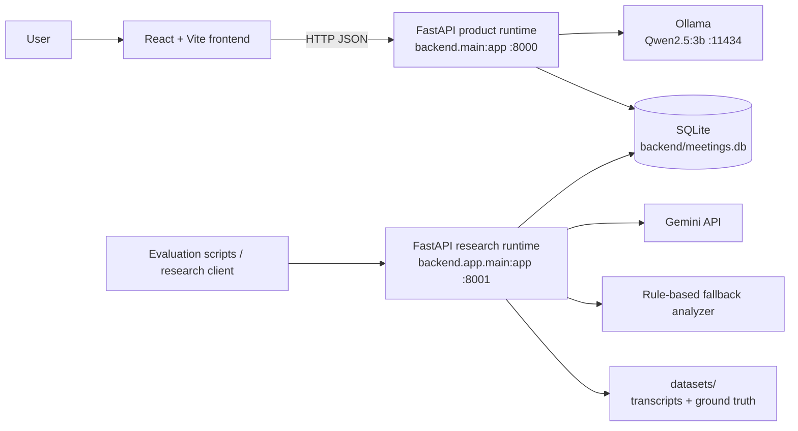
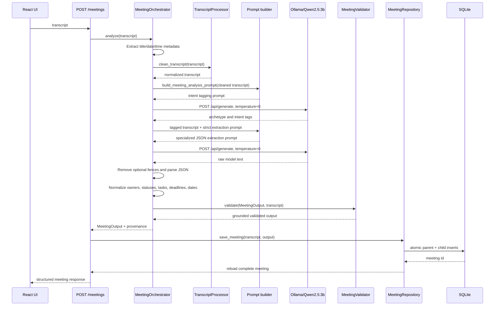
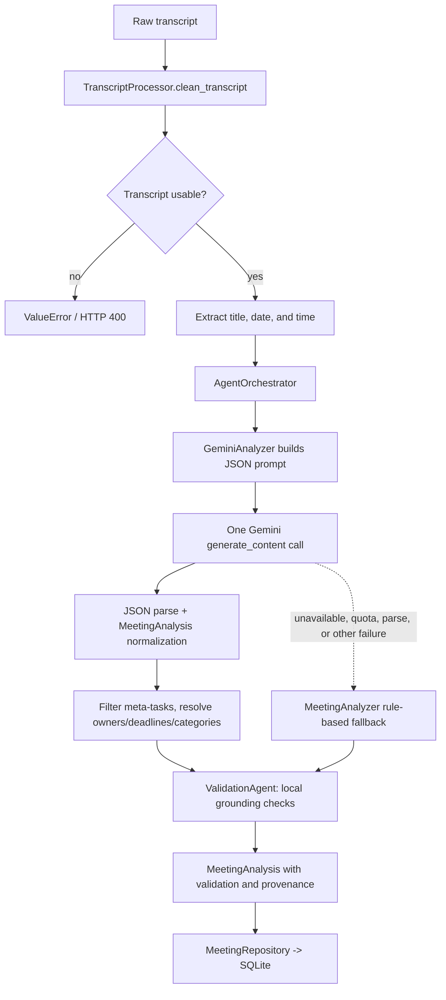
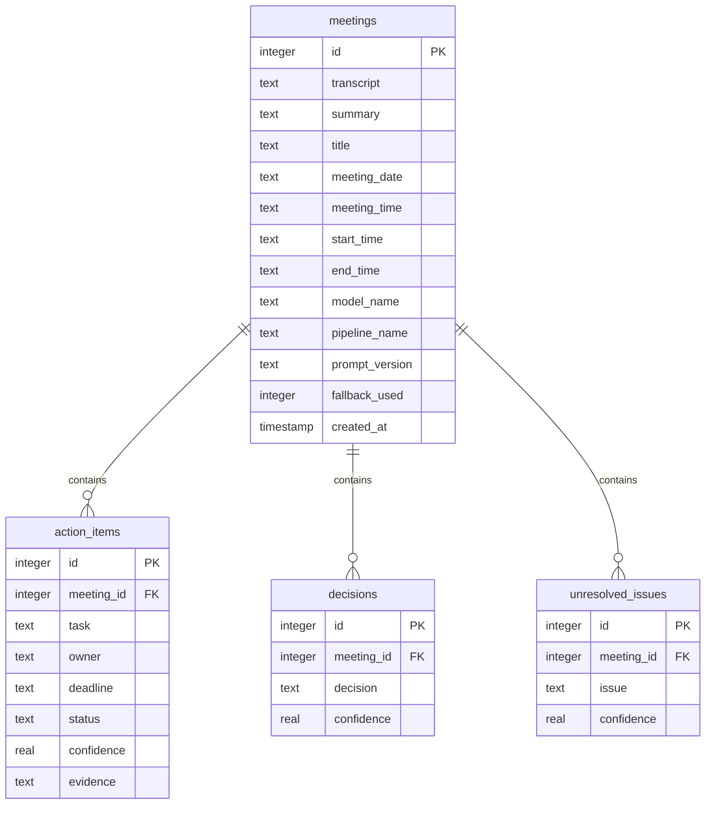
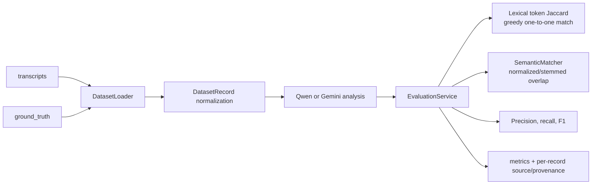

# Project Architecture

This document describes the implemented architecture of the S5 mini datasets meeting-minutes application. There are two intentionally separate application paths:

1. The **canonical product path** serves the React UI and uses local Qwen inference through Ollama.
2. The **research path** exposes Gemini analysis, fallback analysis, dataset loading, and benchmark evaluation.

## System Context



The product and research runtimes share the database file and repository implementation, but they use different Pydantic response models and different AI providers. They should be treated as separate runtime entry points even though they live in the same repository.

## Repository Structure

| Area | Responsibility | Important files |
| --- | --- | --- |
| `frontend/` | React single-page application built with Vite | `src/App.jsx`, `src/services/api.js`, `src/pages/`, `src/components/` |
| `backend/main.py` | Product FastAPI entry point, lifecycle, CORS, error handling | `backend/main.py` |
| `backend/api/` | Product HTTP routes and API DTOs | `backend/api/routes.py`, `backend/api/schemas.py` |
| `backend/ai/` | Ollama client, prompt, parsing, normalization, validation | `orchestrator.py`, `ollama_client.py`, `prompts.py`, `validator.py` |
| `backend/models/` | Product-side Pydantic analysis model | `meeting.py` |
| `backend/database/` | SQLite connection, schema migrations, repository | `connection.py`, `schema.py`, `repository.py` |
| `backend/app/main.py` | Research/evaluation FastAPI entry point | `backend/app/main.py` |
| `backend/app/agents/` | Gemini pipeline orchestration and local validation | `orchestrator.py`, `validation_agent.py` |
| `backend/app/services/` | Transcript processing, Gemini access, fallback analysis, datasets, metrics | `gemini_analyzer.py`, `meeting_analyzer.py`, `evaluation_service.py` |
| `backend/app/schemas/` | Research-side request, response, dataset, and evaluation models | `meeting_schema.py`, `evaluation_schema.py` |
| `datasets/` | Primary transcripts, annotations, benchmarks, and reference material | `01_PRIMARY/`, `02_BENCHMARKS/`, `03_SUPPLEMENTARY/` |
| Root evaluation scripts | Reproducible Qwen/Gemini benchmark runners and experiments | `eval_qwen_SC001_SC070.py`, `eval_gemini_SC001_SC070.py` |
| `tests/` | Unit and integration coverage for APIs, pipelines, persistence, and metadata | `tests/` |

## Runtime 1: Product Application

Start from the repository root:

```text
uvicorn backend.main:app --host 0.0.0.0 --port 8000 --reload
```

Startup initializes the SQLite schema and stores two singletons on `app.state`:

```text
application.state.repository  = MeetingRepository
application.state.orchestrator = MeetingOrchestrator(temperature=0.0)
```

The frontend defaults to `http://127.0.0.1:8000`; override it with `VITE_API_BASE_URL`.

### Product API surface

| Endpoint | Function |
| --- | --- |
| `GET /`, `GET /health` | Health checks |
| `POST /meetings` | Analyze a transcript and atomically persist the result |
| `GET /meetings` | List meetings with counts and provenance |
| `GET /meetings/{meeting_id}` | Retrieve transcript, summary, actions, decisions, and issues |
| `PATCH /meetings/{meeting_id}/action-items/{item_id}/status` | Update an action status |
| `DELETE /meetings/{meeting_id}` | Delete a meeting and cascade-delete child rows |

Route handlers only coordinate dependencies. AI logic is in `backend/ai/`; database logic is in `backend/database/`.

### Frontend workflow

`frontend/src/App.jsx` owns the top-level client state:

```text
health check -> GET /meetings -> GET /meetings/{id} for the first 20 meetings
			 -> aggregate action items, decisions, and issues for cross-meeting views
```

The main views are Overview, Analyze Meeting, Meeting Details, Action Tracker, Decisions, Issues, Timeline, and Analytics. `frontend/src/services/api.js` centralizes HTTP calls, translates non-2xx responses into errors, and handles the 204 delete response.

## Product AI Pipeline: Qwen + Ollama



The prompt requests exactly four top-level fields: `summary`, `action_items`, `decisions`, and `unresolved_issues`. The model is instructed to keep the three extracted categories mutually exclusive, bind owners to explicit speaker commitments, avoid invented deadlines, and return JSON without markdown.

After inference, `MeetingOrchestrator` performs deterministic work:

- Parses the JSON object and rejects malformed or non-object responses.
- Converts action items, decisions, and issues into `MeetingOutput` Pydantic models.
- Normalizes status aliases such as `todo -> pending` and `done -> completed`.
- Resolves task prefixes, speaker owners, relative deadlines, and ISO dates when a meeting date is available.
- Extracts title/date/time metadata from transcript headers; these fields are not generated by the model.
- Rejects known prompt-example leakage and unsupported owners/deadlines.
- Runs `MeetingValidator` against the transcript.

Errors are surfaced by the API as follows: invalid validation gives 400, malformed model JSON gives 502, and model/service failures give 503.

## Runtime 2: Research and Evaluation

Start from the `backend/` directory:

```text
uvicorn app.main:app --host 0.0.0.0 --port 8001 --reload
```

### Research API surface

| Endpoint | Function |
| --- | --- |
| `POST /analyze-meeting` | Run research analysis and persist it through the shared repository |
| `GET /datasets` | Discover supported dataset files and directory collections |
| `POST /evaluate` | Run analysis against a selected dataset and return evaluation metrics |

### Gemini workflow



Despite the `agents/` naming, the research path is not a multi-call autonomous agent loop. `SummaryAgent`, `ActionAgent`, and `DecisionAgent` are modular components retained for compatibility and test injection. With the default components, `AgentOrchestrator` sends one combined prompt to Gemini and performs all category normalization and validation locally. The product Qwen path is separate: it uses an intent-tagging pass followed by the existing structural extraction pass, with automatic one-pass fallback when tagging fails. Set `MEETING_TWO_PASS=false` to disable it.

Gemini access supports configured model selection, JSON response mode, retry/backoff for transient failures, primary/backup key failover for quota errors, and redacted diagnostics. If Gemini cannot produce a valid result, `MeetingAnalyzer` extracts explicit actions, decisions, and unresolved issues with conservative regular-expression rules, then sends the fallback result through the same local `ValidationAgent`.

## Shared Persistence Model

Both runtimes use `backend/database/repository.py` and the default database at `backend/meetings.db`.



`MeetingRepository.save_meeting` writes the meeting and all child rows in one transaction. Connections enable foreign keys, WAL mode, and a busy timeout. Deleting a meeting cascades to its action items, decisions, and unresolved issues. Provenance fields (`model_name`, `pipeline_name`, `prompt_version`, and `fallback_used`) make comparisons reproducible without changing the public shape of older records.

## Dataset and Evaluation Workflow



The benchmark runners preserve the SC001-SC010 methodology while extending it to SC001-SC070:

- `eval_qwen_SC001_SC010.py` and `eval_qwen_SC001_SC070.py` run Qwen through Ollama.
- `eval_gemini_SC001_SC010.py` and `eval_gemini_SC001_SC070.py` run Gemini with retries and checkpointing.
- `eval_qwen_prompt_v2_affected.py` compares the production prompt with the experimental prompt on selected failure cases.
- Raw outputs, checkpoints, and metric JSON files are kept separately so failed or resumed cases are visible.

For each category, the evaluation records lexical token-Jaccard matching at threshold `0.5`, semantic matching through `SemanticMatcher`, and precision/recall/F1. It also records summary availability, parse/validation failures, inference latency, hallucinated owners/deadlines, model source, fallback usage, and rate limiting where available.

## End-to-End Workflows

### User analysis workflow

```text
User enters transcript
  -> React AnalyzeMeeting calls POST /meetings
  -> product orchestrator runs Qwen pipeline
  -> validated output is saved to SQLite
  -> API reloads the saved record
  -> UI opens Meeting Details
  -> App refreshes cross-meeting lists and dashboards
```

### Action status workflow

```text
User changes status
  -> PATCH /meetings/{id}/action-items/{item_id}/status
  -> repository verifies meeting/item relationship and allowed status
  -> SQLite row is updated
  -> UI updates local aggregate state and can reload details
```

### Research benchmark workflow

```text
Select dataset
  -> DatasetLoader discovers files and companion annotations
  -> TranscriptProcessor cleans each transcript
  -> selected AI provider analyzes each record
  -> output is normalized and validated
  -> lexical + semantic matchers compare against ground truth
  -> aggregate metrics and per-record provenance are written/reported
```

## Configuration and Operational Boundaries

- Ollama must be running at `http://localhost:11434`; the default local model is `qwen2.5:3b`.
- `OLLAMA_TIMEOUT_SECONDS` and `OLLAMA_MAX_OUTPUT_TOKENS` control product/evaluation inference limits.
- Gemini credentials and model configuration belong in environment variables or `backend/.env`; use `backend/.env.example` as the template.
- The frontend is a Vite development server and does not serve the API itself.
- SQLite is appropriate for the current local/single-host workflow. There is no queue, object store, authentication layer, or distributed worker in the implemented architecture.
- CORS is currently open for local development and should be restricted before production deployment.

## Architectural Truths and Caveats

1. Qwen plus Ollama is the canonical product implementation and the complete SC001-SC070 application baseline.
2. Gemini is a research/comparison implementation with a rule-based fallback, not the frontend's default provider.
3. The normal AI request is a single LLM call followed by deterministic local validation.
4. The product and research output models are intentionally different; shared persistence is the integration boundary.
5. Evaluation is offline and dataset-driven; it is not part of the normal user request path.
6. Provenance must be preserved when comparing outputs because provider, pipeline, prompt version, and fallback source can differ.

## Security Note

Never commit real API keys. Rotate any key that has been exposed locally before sharing the repository. Restrict CORS and add authentication before exposing the API beyond a trusted local environment.