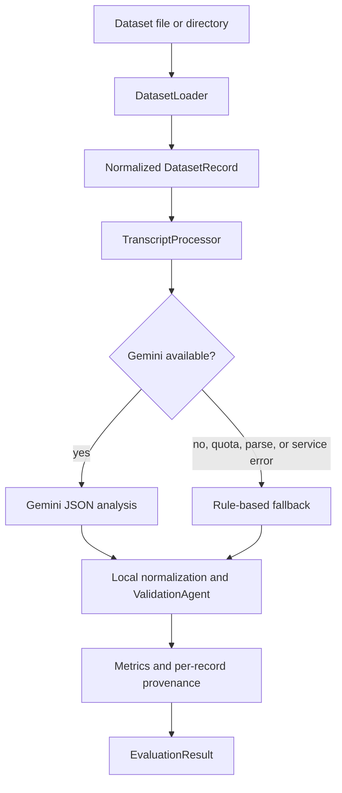
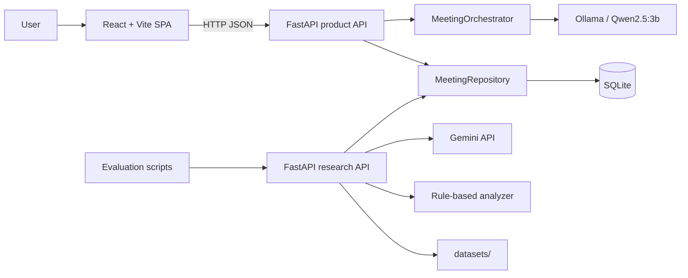
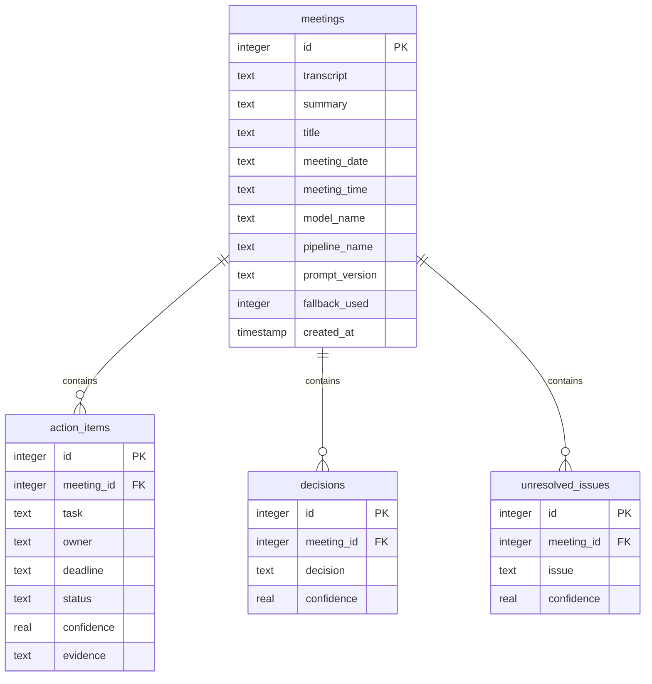

# S5 Meeting Intelligence

AI-assisted meeting minutes, action tracking, decision capture, and benchmark evaluation in one local-first workspace.

S5 turns a raw meeting transcript into a reviewable operating record:

- a concise summary
- grounded action items with owners, deadlines, status, confidence, and evidence
- explicit decisions
- unresolved issues
- searchable, persistent meeting history
- cross-meeting action, decision, issue, timeline, and analytics views

The project is intentionally split into two runtime paths:

| Runtime | Purpose | AI provider | Entry point | Port |
| --- | --- | --- | --- | --- |
| Product | React application used for interactive meeting analysis | Local Qwen2.5:3b through Ollama | `backend.main:app` | `8000` |
| Research | Dataset analysis, provider comparison, and benchmark reporting | Gemini with deterministic fallback | `backend.app.main:app` | `8001` |

Both paths share the SQLite database and repository layer, while keeping their API models and inference workflows separate.

## Runtime and Benchmark Scope

The provider boundaries are deliberate:

| Workflow | Provider | Execution surface | Scope |
| --- | --- | --- | --- |
| Product meeting analysis | Ollama / `qwen2.5:3b` | Product API on port `8000` | Interactive UI workflow |
| Research API analysis | Gemini + rule-based fallback | Research API on port `8001` | Dataset discovery and bounded evaluation |
| Qwen benchmark | Ollama / `qwen2.5:3b` | Offline `eval_qwen_*.py` scripts | SC001-SC070 comparison artifacts |
| Gemini benchmark | Gemini | Offline `eval_gemini_*.py` scripts | Provider comparison; quota may make a run partial |

The offline Qwen benchmark is the current full baseline. The research API's `limit` is intentionally bounded to 50 records per request; the offline runners are the workflow used for the complete SC001-SC070 batch.

## Implementation Status

| Capability | Status |
| --- | --- |
| Local Qwen inference and structured extraction | Implemented; full benchmark artifact available |
| Two-pass intent tagging | Implemented for the product runtime; disable with `MEETING_TWO_PASS=false` |
| SQLite meeting persistence and cascade deletion | Implemented and covered by tests |
| Action-item status updates | Implemented; statuses are documented below |
| Gemini research analysis and fallback | Implemented; requires credentials and provider availability |
| Dataset discovery and bounded evaluation API | Implemented; requires annotated records for scoring |
| Cross-meeting React views, search, and analytics | Implemented in the frontend; frontend build verified |
| Production deployment | Render blueprint included; requires a reachable Ollama service |

## What Makes It Technical

### Deterministic orchestration around a local model

The product request is not a free-form chat loop. It is a bounded extraction pipeline:

```mermaid
flowchart LR
    A[Transcript] --> B[Metadata extraction]
    B --> C[Transcript cleaning]
    C --> D[Intent tagging prompt]
    D --> E[Qwen2.5:3b via Ollama]
    E --> F[Specialized extraction prompt]
    F --> G[Qwen2.5:3b via Ollama]
    G --> H[JSON parsing]
    H --> I[Pydantic normalization]
    I --> J[Transcript grounding validation]
    J --> K[Atomic SQLite persistence]
    K --> L[React meeting workspace]
```



The model is asked for exactly four top-level fields: `summary`, `action_items`, `decisions`, and `unresolved_issues`. Deterministic code then parses, normalizes, validates, and persists the result.

### Grounding and normalization safeguards

After inference, the product orchestrator:

- rejects malformed or non-object JSON responses
- removes optional Markdown fences before parsing
- normalizes status aliases such as `todo` and `done`
- resolves speaker owners, task prefixes, relative deadlines, and ISO dates
- extracts title, date, and time metadata from transcript headers
- rejects unsupported owners, invented deadlines, and known prompt-example leakage
- validates extracted records against the source transcript
- records provider, pipeline, prompt version, and fallback provenance

The product request uses a two-pass Ollama workflow by default. Pass one classifies the meeting archetype and tags evidence as proposal, final decision, assigned task, or unresolved issue. Pass two uses those tags as guidance for the existing strict extractor, then applies the same deterministic normalization and grounding checks. If pass one returns malformed JSON, extraction automatically falls back to the original one-pass prompt. Set `MEETING_TWO_PASS=false` to benchmark or operate the legacy path. The research runtime has separate retry, key-failover, and fallback behavior.

Run the compact archetype benchmark with `python eval_archetypes.py`; its five ground-truthed cases live in `tests/fixtures/archetype_eval.json`.

### Research path with explicit fallback behavior

The research runtime supports Gemini analysis, dataset loading, annotation-aware evaluation, and a rule-based fallback:



Gemini configuration supports model selection, JSON response mode, retry/backoff for transient failures, primary/backup key failover, and redacted diagnostics. The fallback path is conservative: it extracts explicit actions, decisions, and unresolved issues rather than inventing labels.

## Product Architecture



| Area | Responsibility |
| --- | --- |
| `frontend/` | React single-page workspace built with Vite |
| `backend/api/` | Product routes and request/response schemas |
| `backend/ai/` | Ollama client, prompt construction, parsing, normalization, validation |
| `backend/models/` | Product-side Pydantic domain models |
| `backend/database/` | SQLite connection, schema initialization, repository, migrations |
| `backend/app/agents/` | Research orchestration and local validation |
| `backend/app/services/` | Transcript processing, Gemini access, fallback analysis, datasets, metrics |
| `backend/app/schemas/` | Research request and evaluation contracts |
| `datasets/` | Primary transcripts, ground truth, benchmark corpora, and reference material |
| `tests/` | API, AI pipeline, persistence, metadata, and integration coverage |
| `eval_*.py` | Reproducible Qwen and Gemini benchmark runners |

The deeper implementation notes live in [ARCHITECTURE.md](ARCHITECTURE.md).

## Render deployment

The repository includes [`render.yaml`](render.yaml), which defines the product API as a Python Web Service and the React client as a Static Site.

- Deploy from the repository root and select **New > Blueprint** in Render.
- Backend build command: `pip install --upgrade pip && pip install --no-cache-dir -r requirements.txt`
- Backend start command: `uvicorn main:app --host 0.0.0.0 --port $PORT`
- Frontend build command: `npm ci && npm run build`
- Frontend publish directory: `dist`
- The frontend receives the backend URL from the blueprint configuration.
- Set the backend `OLLAMA_BASE_URL` secret to a reachable Ollama-compatible HTTPS endpoint. Render does not run the local `localhost:11434` Ollama server.
- Keep `OLLAMA_MODEL` aligned with the model installed on that endpoint.
- Set `CORS_ORIGINS` to the exact frontend Render URL plus any local development URLs.

The default SQLite database is stored on the service filesystem. Render free services have ephemeral filesystems, so meeting data can be lost on redeploy or restart. Use a persistent disk or migrate the repository layer to a managed database before treating the deployment as production storage.

## Frontend Experience

The React workspace provides:

- overview dashboard with meeting and extraction counts
- transcript analysis flow
- complete meeting detail view
- action tracker with live status changes
- decision and unresolved issue views
- meeting timeline
- cross-meeting analytics
- global search with `Ctrl+K` / `Cmd+K`
- dark and light themes persisted in local storage
- backend health visibility and an in-app technical architecture view

The client keeps HTTP behavior in `frontend/src/services/api.js`, translates non-2xx responses into actionable errors, and refreshes aggregate cross-meeting state after mutations.

## Persistence Model



`MeetingRepository.save_meeting` writes the parent meeting and all child rows in one transaction. SQLite connections enable foreign keys, WAL mode, a 10-second connection timeout, and a 5-second busy timeout. Deleting a meeting cascades to its extracted child records. Provenance fields make model comparisons reproducible without changing the older public record shape.

### Database and concurrency

Both runtimes resolve the default database to `backend/meetings.db`. Each FastAPI lifespan initializes the schema, then creates a repository using that file. Initialization creates missing tables and applies guarded additive column migrations; there is no versioned migration tool or migration history table.

WAL and busy-timeout settings provide basic coordination for the current local or single-host workflow, but the repository does not claim distributed database safety. Concurrent writes from both servers are not covered by the current test suite. Run one write-heavy workflow at a time, back up `backend/meetings.db`, and move to a server database before multi-host deployment.

## API Surface

### Product API: `http://127.0.0.1:8000`

| Method | Route | Behavior |
| --- | --- | --- |
| `GET` | `/`, `/health` | Service health |
| `POST` | `/meetings` | Analyze a transcript and persist the result |
| `GET` | `/meetings` | List meetings with extraction counts |
| `GET` | `/meetings/{meeting_id}` | Retrieve transcript and complete analysis |
| `PATCH` | `/meetings/{meeting_id}/action-items/{item_id}/status` | Update an action status |
| `DELETE` | `/meetings/{meeting_id}` | Delete a meeting and cascade child rows |

Example:

```powershell
Invoke-RestMethod http://127.0.0.1:8000/health

$body = @{
        transcript = "Alex: I will send the report by Friday."
} | ConvertTo-Json

Invoke-RestMethod `
        -Uri "http://127.0.0.1:8000/meetings" `
        -Method Post `
        -ContentType "application/json" `
        -Body $body
```

The action-item status update accepts only `pending`, `in_progress`, `completed`, or `cancelled`. Invalid transcript bodies return `422`; validation failures return `400`; malformed model output returns `502`; unavailable Ollama services return `503`; persistence failures return `500`.

### Representative normalized response

The product API returns persisted records with IDs, provenance, and child-row metadata:

```json
{
    "meeting_id": 42,
    "summary": "The team confirmed the event plan and assigned follow-up work.",
    "action_items": [
        {
            "id": 101,
            "meeting_id": 42,
            "task": "Send the final report",
            "owner": "Alex",
            "assignee": "Alex",
            "deadline": "Friday",
            "status": "pending",
            "confidence": 1.0,
            "confidence_score": 1.0,
            "evidence": null
        }
    ],
    "decisions": [
        { "id": 102, "meeting_id": 42, "decision": "Approved the event plan", "confidence": 1.0 }
    ],
    "unresolved_issues": [
        { "id": 103, "meeting_id": 42, "issue": "Room confirmation is still pending", "confidence": 1.0 }
    ],
    "model_name": "qwen2.5:3b",
    "pipeline_name": "ollama_product",
    "prompt_version": "production",
    "fallback_used": false
}
```

### Research API: `http://127.0.0.1:8001`

| Method | Route | Behavior |
| --- | --- | --- |
| `POST` | `/analyze-meeting` | Run research analysis and persist it |
| `GET` | `/datasets` | Discover supported files and directory collections |
| `POST` | `/evaluate` | Evaluate a bounded dataset selection |

Evaluation requests accept `limit` from `1` through `50` and optional pacing from `0` through `10` seconds. Supported source formats include CSV, JSON, JSONL, TXT, and `.transcript`.

```json
{
  "dataset_name": "01_PRIMARY/student_club/transcripts/SC001.txt",
  "limit": 1,
  "pacing_seconds": 0
}
```

## Dataset and Evaluation Design

The dataset root is organized by purpose:

| Location | Contents |
| --- | --- |
| `01_PRIMARY/student_club/` | SC001-SC070 transcripts, ground truth, metadata, and documentation |
| `02_BENCHMARKS/` | QMSum and MeetingBank benchmark material |
| `03_SUPPLEMENTARY/` | MISeD data |
| `04_REFERENCE/` | AMI, ELITR Bench, and ICSI reference corpora |
| `99_ARCHIVE_NOTES/` | Preserved historical/raw copies, outside the active workflow |

The evaluation service reports:

- summary availability
- action, decision, and issue precision, recall, and F1
- reference, prediction, and match counts
- lexical token-Jaccard matching with a `0.5` threshold
- semantic matching through `SemanticMatcher`
- processed and skipped records
- Gemini, fallback, and rate-limited record counts
- per-record source, model, pipeline, prompt version, and fallback provenance

Benchmark runners preserve raw outputs, checkpoints, metrics, and reports so interrupted experiments remain auditable:

```powershell
python eval_qwen_SC001_SC010.py
python eval_qwen_SC001_SC070.py
python eval_gemini_SC001_SC010.py
python eval_gemini_SC001_SC070.py
```

Experimental prompt comparisons are kept separate from the canonical benchmark path, including `eval_qwen_prompt_v2_affected.py` and the associated `*_v2_*` / `*_v3_*` artifacts.

### Evaluation methodology and limitations

For each category, predictions and references are counted per labeled record. Lexical matching tokenizes lowercase word sets and uses greedy one-to-one Jaccard matching at `>= 0.5`; duplicate references cannot be matched twice. The research API aggregates category counts across labeled records, while the offline benchmark scripts additionally report macro and micro PRF. Semantic matching uses the repository's normalized `SemanticMatcher` with the same one-to-one intent. Missing reference annotations make a metric unavailable rather than treating the record as a negative example.

Summary availability is only a non-empty-summary check; it is not a summary quality score. Metric values are sensitive to annotation wording, category granularity, the selected record population, provider, model, prompt version, and skipped/rate-limited records.

### Current benchmark evidence

The checked-in Qwen v3 metrics artifact reports a complete SC001-SC070 run: 70/70 records parsed and validated, zero hallucinated owners or deadlines, semantic macro F1 of `0.7721` for actions, `0.8530` for decisions, and `0.6929` for unresolved issues. These are benchmark metrics, not guarantees for arbitrary transcripts.

The checked-in Gemini artifact is partial: 6 successful records and 64 quota/parse failures out of 70 attempts. Its semantic macro F1 values (`0.9206` actions, `1.0000` decisions, `0.9111` issues) must not be compared directly with the complete Qwen run. See [QWEN_SC001_SC070_BENCHMARK_REPORT.md](QWEN_SC001_SC070_BENCHMARK_REPORT.md) and [GEMINI_SC001_SC070_BENCHMARK_REPORT.md](GEMINI_SC001_SC070_BENCHMARK_REPORT.md) for scope and caveats.

The primary student-club corpus has SC001-SC070 transcript and ground-truth files. The benchmark scripts use those files as one evaluation population; this repository does not currently enforce a separate prompt-tuning train/dev/test split in the runners. Experimental prompt outputs are stored separately and should not be treated as an independent final test set.

## Local Setup

### Prerequisites

- Python 3.10+ recommended
- Node.js and npm
- Ollama for the product runtime
- Qwen2.5:3b pulled into Ollama
- Gemini API credentials only for the research runtime

### 1. Create the Python environment

From the repository root:

```powershell
python -m venv backend/venv
Set-ExecutionPolicy -Scope Process -ExecutionPolicy RemoteSigned
.\backend\venv\Scripts\Activate.ps1
python -m pip install --upgrade pip
pip install -r backend/requirements.txt
```

### 2. Start the local model

Install Ollama, then pull the configured product model:

```powershell
ollama pull qwen2.5:3b
ollama serve
```

The product runtime expects Ollama at `http://localhost:11434`. The current client uses this base URL as a constructor default; there is no documented `OLLAMA_BASE_URL` environment variable. Relevant controls include `OLLAMA_TIMEOUT_SECONDS` and `OLLAMA_MAX_OUTPUT_TOKENS`.

### 3. Start the product backend

```powershell
uvicorn backend.main:app --host 0.0.0.0 --port 8000 --reload
```

The backend initializes `backend/meetings.db` at startup.

### 4. Start the frontend

In a second terminal:

```powershell
cd frontend
npm install
npm run dev
```

The frontend defaults to `http://127.0.0.1:8000` for the API. Override it before starting Vite when needed:

```powershell
$env:VITE_API_BASE_URL = 'http://127.0.0.1:8000'
npm run dev
```

### 5. Run the research runtime

Copy [backend/.env.example](backend/.env.example) to `backend/.env` and fill in Gemini credentials, then run from `backend/`:

```powershell
cd backend
uvicorn app.main:app --host 0.0.0.0 --port 8001 --reload
```

The product and research servers should be treated as separate entry points even though they share the repository and database implementation.

### Complete local run

| Terminal | Command | Required for product UI? |
| --- | --- | --- |
| 1 | `ollama serve` | Yes |
| 2 | `uvicorn backend.main:app --host 0.0.0.0 --port 8000 --reload` | Yes |
| 3 | `cd frontend; npm run dev` | Yes |
| 4 | `cd backend; uvicorn app.main:app --host 0.0.0.0 --port 8001 --reload` | No, research only |

The frontend uses port `8000`; the research backend is independent and is not required for interactive product analysis.

## Verification

Run the offline Python suite from the repository root:

```powershell
python run_unit_tests.py
```

Run the frontend checks:

```powershell
cd frontend
npm run lint
npm run build
```

The test suite covers API contracts, mocked AI orchestration, persistence and cascade behavior, metadata extraction, dataset evaluation, Gemini key management, and integration flows.

## Configuration Reference

| Variable | Purpose | Required | Default |
| --- | --- | --- | --- |
| `OLLAMA_TIMEOUT_SECONDS` | Product/evaluation inference timeout | No | `120` seconds in `OllamaClient`; benchmark runner fallback is `180` seconds |
| `OLLAMA_MAX_OUTPUT_TOKENS` | Optional Ollama `num_predict` limit | No | Unset |
| `GEMINI_API_KEY_PRIMARY` | Primary research Gemini credential | Conditional | Unset |
| `GEMINI_API_KEY_BACKUP` | Backup research Gemini credential | No | Unset |
| `GEMINI_API_KEY` | Compatibility key used by some offline benchmark scripts | Conditional for those scripts | Unset |
| `GEMINI_MODEL` | Research Gemini model | No | `gemini-3.5-flash-lite` in the research service; benchmark scripts may define their own default |
| `GEMINI_KEY_MODE` | Key selection: `auto`, `primary`, or `backup` | No | `auto` |
| `VITE_API_BASE_URL` | Frontend product API URL | No | `http://127.0.0.1:8000` |

The database path is not environment-configurable in the current implementation; it defaults to `backend/meetings.db`. Keep credentials in `backend/.env`, which is based on [backend/.env.example](backend/.env.example), and never commit real keys.

## Troubleshooting

| Symptom | Check |
| --- | --- |
| Frontend cannot connect | Confirm the product backend is on port `8000` and `VITE_API_BASE_URL` is correct |
| Ollama service unavailable | Run `ollama serve`, confirm `ollama list`, and pull `qwen2.5:3b` |
| Inference times out | Increase `OLLAMA_TIMEOUT_SECONDS` or reduce transcript/model output size |
| AI output is unparseable | Retry after checking Ollama logs; the API returns `502` and does not persist the invalid result |
| Gemini research is unavailable | Confirm the relevant key variable, model name, and quota; fallback/provenance fields identify fallback records |
| Database is locked | Stop duplicate local server processes and retry; shared SQLite is not a multi-host deployment target |
| PowerShell blocks npm | Run `npm.cmd run lint` / `npm.cmd run build`, or use a process-scoped execution policy |

## Configuration and Operational Boundaries

- The product path is local-first and uses Qwen through Ollama.
- Gemini is for research and comparison; it is not the frontend's default provider.
- SQLite is designed for the current local or single-host workflow.
- There is no queue, object store, authentication layer, or distributed worker in the implemented architecture.
- CORS is open for local development and must be restricted before external deployment.
- Transcripts are sent to local Ollama in the product path and persisted in SQLite; research Gemini requests send transcripts to Google's API when configured.
- Back up `backend/meetings.db` before experiments that write through the research API.
- Never commit real API keys. Rotate any key exposed in a local environment before sharing the repository.

## Project Notes

- [ARCHITECTURE.md](ARCHITECTURE.md) contains the detailed implementation architecture and sequence diagrams.
- [backend/DATASET_EVALUATION.md](backend/DATASET_EVALUATION.md) documents dataset discovery, normalization, and evaluation semantics.
- [datasets/DATASET_STRUCTURE_FINAL.md](datasets/DATASET_STRUCTURE_FINAL.md) documents the active dataset layout and preserved archive boundaries.
- [GEMINI.md](GEMINI.md) and the benchmark reports document provider-specific experiments.

## License

No license file is currently included. Add the project license before distributing the repository outside its intended development context.